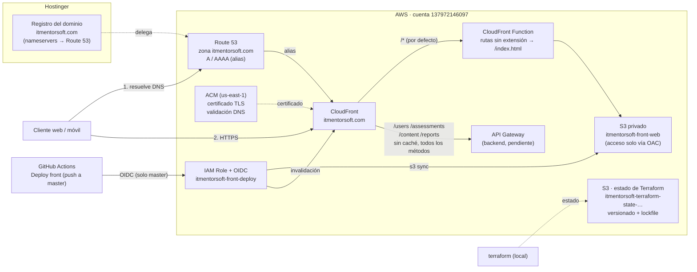

# Infraestructura del front (AWS)

CloudFront + S3 privado + ACM + Route 53. El dominio sigue registrado en Hostinger; solo se delegan los nameservers a Route 53.



Sin `api_origin_domain`, CloudFront solo sirve el front y no enruta el API (la flecha hacia API Gateway aún no está activa).

## Primer despliegue

Requiere credenciales de AWS con permisos para crear estos recursos.

1. Crear solo la zona DNS:
   ```
   cd infra
   terraform init
   terraform apply '-target=aws_route53_zone.main'
   ```
   (Las comillas son necesarias en PowerShell; sin ellas parte el argumento en el punto.)
2. Copiar los 4 valores de `name_servers` (`terraform output name_servers`) en Hostinger:
   Dominios -> itmentorsoft.com -> Administrar -> Servidores de nombres.
   Esperar la propagación (minutos a algunas horas).
3. Crear todo lo demás (la validación del certificado espera a la propagación):
   ```
   terraform apply
   ```
4. Crear en GitHub (Settings -> Secrets and variables -> Actions -> **Variables**) las 4 variables que muestra `terraform output github_variables`:
   `AWS_ROLE_ARN`, `AWS_REGION`, `S3_BUCKET`, `CLOUDFRONT_DISTRIBUTION_ID`.
5. Hacer merge a `master`: el workflow `Deploy front` compila, sube a S3 e invalida la caché.

## Conectar el API

Mientras `api_origin_domain` esté vacío, CloudFront solo sirve el front. Cuando exista el API Gateway:

```
terraform apply -var 'api_origin_domain=abc123.execute-api.us-east-1.amazonaws.com'
```

Si el API Gateway usa un stage con nombre (ej. `/prod`), agregar `-var 'api_origin_path=/prod'`.

### Apuntar directo al servidor EC2 (sin API Gateway)

El backend también está publicado en un EC2 que expone la API por HTTP en el puerto 8000. CloudFront puede usarlo como origen:

```
terraform apply \
  -var 'api_origin_domain=ec2-98-95-193-167.compute-1.amazonaws.com' \
  -var 'api_origin_protocol=http-only' \
  -var 'api_origin_http_port=8000'
```

Para no repetir las variables se pueden guardar en `terraform.tfvars` (ignorado por git).

Cosas a tener en cuenta:

- El origen debe ser el **DNS público** del EC2 (CloudFront no acepta IP). Ese DNS cambia si el servidor se apaga y se enciende, salvo que tenga una IP elástica asociada.
- El tramo CloudFront -> servidor va **sin cifrar** (HTTP). El navegador sí usa HTTPS contra `itmentorsoft.com`.
- El grupo de seguridad del EC2 debe permitir el puerto 8000 desde internet (o desde los rangos de CloudFront).
- Como el API se sirve bajo el mismo dominio que el front, no se necesita CORS.
- Rutas que llegan al API: `/users`, `/assessments`, `/content` y `/reports` (ver `api_path_prefixes`). `/docs` y `/openapi.json` no pasan por CloudFront; se consultan directo en el puerto del servidor.
- Comprobar después del `apply` (la distribución tarda unos minutos en actualizarse): `curl -i https://itmentorsoft.com/users/available-roles` debe responder `401` (la respuesta del API) y no la página web.
- **Guarda estos valores en `infra/terraform.tfvars`** (está ignorado por git). Si un `apply` posterior no los trae, vuelve a dejar el API desconectado.

## Si el despliegue de GitHub falla con `Not authorized to perform sts:AssumeRoleWithWebIdentity`

El rol compara el `sub` del token de GitHub con lo que permite. GitHub puede enviarlo en dos formatos: el clásico (`repo:dueño/repo:ref:refs/heads/master`) o con ids numéricos (`repo:dueño@<id>/repo@<id>:ref:refs/heads/master`). El rol acepta ambos (`github_subjects` en `github_oidc.tf`); los ids están en las variables `github_owner_id` y `github_repository_id`. Si el repositorio se transfiere o se recrea, hay que actualizar esos ids. Para ver lo que GitHub envía, el workflow tiene el paso `Debug OIDC claims`.

## Notas

- `create_github_oidc_provider`: AWS permite un solo proveedor OIDC de GitHub por cuenta. Si ya existe, usar `-var create_github_oidc_provider=false`.
- El estado de Terraform está en S3 (`itmentorsoft-terraform-state-137972146097`, clave `front/terraform.tfstate`, con versionado y bloqueo nativo). Ese bucket se creó a mano y no lo gestiona este Terraform; no borrarlo. Los archivos `*.tfstate` locales están ignorados por git.
- Las rutas de Angular (sin extensión) se resuelven con una CloudFront Function que sirve `/index.html`. No se usa `custom_error_response` porque afectaría también a los 403/404 del API.
